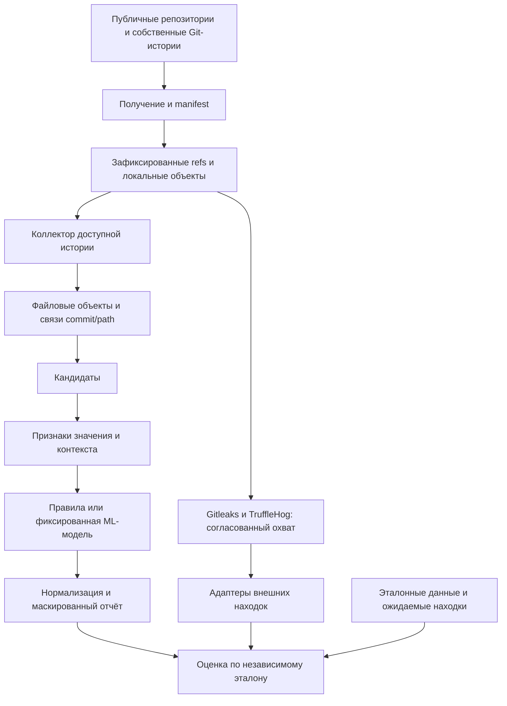
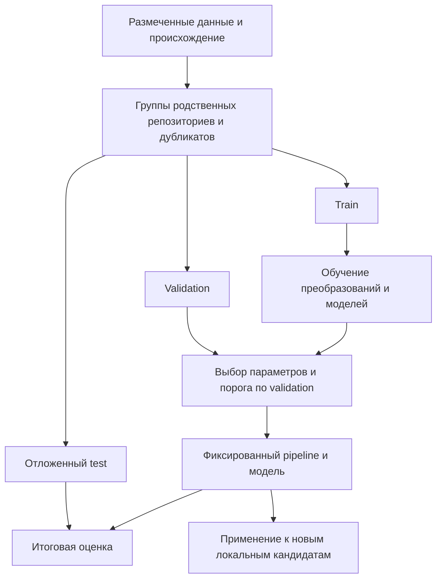

# Архитектура дипломного проекта

**Тема:** Разработка метода обнаружения утечек конфиденциальных данных в истории публичных Git-репозиториев на основе методов искусственного интеллекта.

**Команда:** два автора.  
**Версия документа:** 0.1, 14 октября 2026 года.  
**Статус:** проект архитектуры на основе предоставленных материалов; не отчёт о реализации и не утверждённое руководителем техническое задание.  
**Основной календарный источник:** «roadmap 1.pdf», период 12 октября — 1 декабря 2026 года. Противоречия внутри его дат сохранены в разделе 18.

## Как читать документ

**Из roadmap** — требования пользовательского PDF. **Из подготовленных материалов** — ранее описанные решения, часть которых ещё требует согласования. **Предлагаемая детализация** — новое устройство компонентов, связей и проверок, которое предлагается принять для реализации. Ни одна из этих отметок не означает, что соответствующий модуль уже написан.

Основа — [R0](#r0), [R1](#r1), [R2](#r2) и материалы этапа постановки [R3–R11](#local-sources). Источники указаны у разделов; внешние ссылки из прежнего реестра приведены в разделе 22. Новые измерения, результаты сканирования, действующие credentials, названия невыбранных AWS-сценариев и даты защиты в документ не добавлены.

Документ охватывает программный конвейер, данные, обучение, эксперимент, безопасность, организацию кода, распределение на двоих и связь с текстом диплома. Схемы Mermaid — текстовое описание проектируемых связей; они не подтверждают наличие работающего приложения.

## 1. Назначение и исследовательская задача

**Цель из roadmap:** получить работающий локальный прототип по цепочке «доступная Git-история → кандидаты → признаки и контекст → ML-классификация → отчёт» и проверить, уменьшает ли контекст число ложных срабатываний при сопоставимой полноте. [R0](#r0)

Основная практическая задача в подготовленных материалах — классификация кандидатов как секретного или несекретного материала. Девять категорий служат для разметки и анализа ошибок; отдельный девятиклассовый классификатор не утверждён. Сужение общей темы «конфиденциальные данные» до этих групп секретов ещё нужно согласовать. [R3](#r3), [R4](#r4), [R7](#r7)

| Исследовательский вопрос из подготовленных материалов | Что в архитектуре позволяет его проверить |
|---|---|
| RQ1. Какова полнота извлечения из доступной истории, включая отсутствующее в выбранном текущем снимке? | Коллектор, сохранение происхождения, независимые ожидаемые находки в тестовых историях, отдельная оценка извлечения. |
| RQ2. Снижает ли контекст FP при сопоставимом recall? | Парные варианты одной модельной семьи на одних кандидатах и одном разбиении: без контекста / с контекстом. |
| RQ3. Как соотносятся качество и время с baseline? | Отдельные запуски собственного метода, Gitleaks и TruffleHog, нормализация результатов и общий протокол оценки. |

RQ остаются рабочими формулировками, а не подтверждёнными выводами. Основание: [R5](#r5), [R9](#r9).

## 2. Границы системы

**В обязательном плане:** локальный статический анализ доступных исторических файловых объектов; сохранение commit/path и диапазонов строк; маскированные JSON/CSV-отчёты; HMAC-отпечатки; обучение Logistic Regression и Random Forest; проверка TF-IDF; сравнение с внешними baseline. [R0](#r0)

**За пределами обязательного прототипа по подготовленным материалам:** использование найденных credentials, онлайн-проверка доступа, выполнение кода целевых проектов, облачная эксплуатация, внешние LLM/API для обработки находок, веб-интерфейс, GPU, обязательное развёртывание AWS. Статьи об issue reports не включают issue reports в наш корпус автоматически. [R2](#r2), [R6](#r6)

«Доступная история» ограничена объектами, достижимыми из фактически полученных веток и тегов. Скрытые refs, недостижимые коммиты, внешние submodules, LFS-объекты и история отдельных форков не считаются включёнными без отдельного получения и фиксации. Нельзя обещать восстановление любой когда-либо существовавшей истории. [R0](#r0), [R6](#r6)

## 3. Общая архитектура

**Предлагаемая детализация:** один локальный проект на Python с функциональными модулями и CLI, а не набор микросервисов. Основание выбора — предусмотренные командная строка, локальная модель и локальное хранение, а также отсутствие веб-интерфейса в обязательном MVP. Разделение на модули нужно для независимой проверки коллектора, детекции и ML; оно не требует отдельных серверов. [R1](#r1), [R2](#r2)

У системы два связанных режима:

**Сканирование:** зафиксированная локальная история → кандидаты → фиксированные правила либо ранее обученная модель → замаскированные находки.

**Эксперимент:** данные и эталонная разметка → группировка и split → обучение/выбор на train/validation → замороженный метод → test → сравнение и выводы.

```text
ИСТОЧНИКИ
Публичные Git-репозитории / собственные Git-истории
                    │
           Получение и manifest
                    │
          Локальная зафиксированная копия
                    │
          Коллектор достижимой истории
                    │
       Файловые объекты + commit/path
                    │
          Извлечение кандидатов
                    │
          Признаки значения и контекста
                    │
       Правила ИЛИ фиксированная ML-модель
                    │
         Нормализация и маскировка
                    │
              JSON / CSV

ПАРАЛЛЕЛЬНО ДЛЯ СРАВНЕНИЯ
Та же согласованная область истории → Gitleaks / TruffleHog
                                   → адаптеры находок
                                   → общий протокол оценки

ОТДЕЛЬНО ДЛЯ ОБУЧЕНИЯ И ОЦЕНКИ
Размеченные данные + известные ответы тестовых историй
→ группы → train / validation / test
→ обучение → выбор → фиксированная модель → эксперимент
```



Gitleaks и TruffleHog здесь не являются обязательными внутренними этапами собственного детектора. Они обрабатывают согласованную область данных независимо; их метки не заменяют эталон. Это детализация протокола сравнения из [R9](#r9).

## 4. Компоненты, входы и выходы

Названия модулей развивают структуру из `read.me`. Контракты ниже — **предложение для реализации**, а не существующие API. [R1](#r1)

| Модуль | Вход | Ответственность | Выход |
|---|---|---|---|
| `corpus` | Выбранные источники, роли, правила получения | Зафиксировать происхождение, доступ, ревизии, refs, семейства и ограничения | Manifest и локальные ссылки на данные |
| `git_history` | Локальный репозиторий, зафиксированные refs | Прочитать достижимые коммиты и файловые объекты; сохранить появления файлов | Объекты, commit/path, пропуски и покрытие |
| `candidates` | Текст файлового объекта | Извлечь строковые фрагменты, блоки ключей и связанные компоненты | Кандидаты со span и причиной извлечения |
| `features` | Кандидат, текст, путь и версия схемы | Посчитать признаки значения и выбранные признаки контекста | Числовое и текстовое представление |
| `baselines` | Согласованная область данных и конфигурации | Собственные правила; отдельные адаптеры Gitleaks/TruffleHog | Нормализованные решения методов |
| `ml` | Размеченные группы либо новые признаки | Обучение и подбор только в экспериментальном режиме; применение фиксированной модели при сканировании | Model artifact, score и решение |
| `evaluation` | Эталон, предсказания и протокол | Сопоставить находки, учесть пропуски, посчитать метрики и срезы | Таблицы качества, времени и ошибок |
| `reporting` | Решения, происхождение, покрытие | Замаскировать значения и контекст; подготовить разрешённый экспорт | JSON/CSV, сводка Markdown |
| `storage` | Метаданные, связи, версии артефактов | Локально хранить данные с разделением открытых и чувствительных частей | SQLite и служебные файлы |
| `cli` | Конфигурация выбранного режима | Последовательно вызвать модули, фиксировать параметры и сбои | Воспроизводимый локальный запуск |

**Предлагаемое правило зависимостей:** коллектор не зависит от ML; разметка не зависит от решения baseline; отчёт не меняет предсказания; модуль оценки не обучает модель на test. Это позволяет отдельно объяснять и проверять ошибки каждой части.

## 5. Архитектура Git-истории

### 5.1. Получение и фиксация

Сначала выбираются источники, затем сохраняются фактически полученные refs, их ревизии, дата получения и выбранный текущий снимок. Каталог из 60 ссылок и предложенный пилот из 12 источников — не доказательство, что репозитории уже скачаны. [R0](#r0), [R1](#r1)

В `req.md` предусмотрены Git CLI, `subprocess`, `rev-list`, `ls-tree` и `cat-file`; аргументы процессов передаются списком, без `shell=True`. Основной эксперимент не должен молча использовать shallow-историю. Окончательные версии и команды ещё требуется проверить запуском. [R2](#r2)

### 5.2. Объекты и появления — разные сущности

**Требование плана:** обрабатывать уникальные версии файлов и сохранять commit/path. **Предлагаемая реализация:** отдельно хранить содержимое файлового объекта и таблицу его появлений в коммитах/путях. [R0](#r0)

Содержимое одного объекта извлекается один раз, но сведения о всех относящихся к нему появлениях сохраняются. При этом путь — предполагаемый контекстный признак. Поэтому нельзя объединить разные пути так, чтобы потерялся контекст для ML. Предлагается кэшировать извлечение по файловому объекту, а представление контекста — по объекту, диапазону, пути и версии схемы признаков.

Обход не должен сводиться к поиску добавленных строк в diff: архитектурное требование — находить также начальный коммит, многострочные блоки и версии, отсутствующие в текущем снимке. Конкретную реализацию проверяют тесты, а не наличие слова «полная история» в описании.

### 5.3. Сравнение с текущим состоянием

В manifest нужно фиксировать `reference_snapshot_oid`: с каким именно коммитом сравниваются исторические находки. Одного обозначения `HEAD` без сохранённой ревизии недостаточно для воспроизводимого опыта. [R6](#r6), [R9](#r9)

**Предлагаемая детализация:** различать «этого исторического места нет в снимке» и «этого значения нет нигде в снимке». Переименованный файл не должен автоматически доказывать удаление секрета. Для сравнения значений предлагается использовать согласованные HMAC-отпечатки; для оценки — принятую единицу находки. Итоговое правило `history_only` остаётся на согласование.

Порядок обхода не следует подписывать как доказанное время первого раскрытия. Если понадобятся «первое/последнее появление», для ветвящегося графа потребуется отдельное определение; обязательный MVP сохраняет доказуемые связи с коммитами.

### 5.4. Покрытие

Журнал покрытия должен показывать обработанные объекты, ограничения размера/кодировки/формата, отсутствующие объекты, ошибки чтения, неохваченные LFS и submodules. Пустой результат после ошибки чтения не равен «секретов нет». Политика лимитов пока не задана численно. Основание требований: [R2](#r2), [R6](#r6).

## 6. Источники данных и разметка

### 6.1. Источники нельзя смешивать по назначению

| Источник по материалам | Назначение в архитектуре | Что не подтверждено |
|---|---|---|
| Пилот из каталога репозиториев | Проверка получения, покрытия и анализа выбранных проектов | Окончательный состав, скачивание и наличие полного эталона |
| Собственные Git-истории | Известные положительные и отрицательные случаи; проверка истории | Наличие уже созданных и выполненных fixtures |
| SecretBench | Планируемый источник размеченных примеров | Доступ команды и фактическое включение данных |
| CredData | Планируемый источник с собственной семантикой меток | Полученная версия, отображение меток и независимость от других данных |
| Pathfinding.cloud | Основа описаний трёх контролируемых AWS-сценариев | Выбранные сценарии и их Git-адаптации |

Основание: [R0](#r0), [R3](#r3), [R6](#r6), [R11](#r11).

Ранее подготовленный реестр описывает условия доступа к SecretBench и особенности CredData. Здесь эти наборы не объявляются уже доступными. Если импорт содержит только фрагменты и метки, архитектура не приписывает ему несуществующую полную Git-историю. Такие данные можно рассматривать для поддерживаемой задачи классификации; историческое покрытие проверяется только там, где доступна соответствующая история и эталон. Последнее — предлагаемая политика импорта.

### 6.2. Два вида эталонных данных

**Размеченные кандидаты** нужны для обучения и парного сравнения ML-вариантов.

**Независимые ожидаемые находки** нужны для полноты извлечения и сквозной оценки. Их нельзя получать только из результата собственного детектора: иначе отсутствующий кандидат не попадёт в эталон и не будет посчитан пропуском. На собственных историях ожидаемые места задаются при создании сценария. На внешнем наборе сохраняется область, для которой действительно предоставлена разметка. Это детализация [R5](#r5) и [R9](#r9).

### 6.3. Метки и разногласия

В материалах предложены `SECRET`, `NON_SECRET`, `UNCERTAIN`; сохраняются исходная метка набора, происхождение, обоснование и `activity_status = UNKNOWN`. `SECRET` означает секретный материал по принятой политике, а не подтверждённый доступ. Категория, происхождение и действительность credentials — разные поля. [R1](#r1), [R7](#r7)

Для двух авторов ранее предложена независимая разметка с последующим обсуждением. Неразрешённые случаи остаются `UNCERTAIN`; их нельзя автоматически делать отрицательными. Для основной бинарной оценки нужно указать долю согласованных/исключённых данных. Процедура ещё не утверждена; строка про «третьего» в PDF остаётся несогласованностью. [R9](#r9), [R10](#r10)

### 6.4. Группировка перед split

Родственные репозитории, повторы значений и общие шаблоны должны учитываться до разделения. Синтетический набор и независимые данные оцениваются отдельно. Доли train/validation/test и random seed в материалах не заданы. [R0](#r0), [R2](#r2), [R9](#r9)

**Предлагаемая реализация:** строить группы, объединяющие связанные семейства и дубликаты между источниками; всю группу назначать одной части. Если связанные данные образуют слишком крупную группу для нужного разбиения, пересматривать состав корпуса, а не разрывать её незаметно. HMAC-ключ и правила нормализации должны быть согласованы для сравниваемого корпуса. Независимость внешнего набора проверяется, а не выводится из его названия.

## 7. Схема данных

**Статус:** концептуальная схема. Названия полей и сущностей ниже предложены для реализации на основе ранее перечисленных метаданных. Это не уже созданная база, не заполненный manifest и не окончательная единица оценки. [R0](#r0), [R1](#r1), [R2](#r2), [R9](#r9)

| Сущность | Основные поля | Смысл |
|---|---|---|
| `CorpusSource` | `source_id`, тип источника, `repo_url`, `family_id`, роль, версия, условия доступа/использования | Происхождение данных; не каждый источник является полной Git-копией |
| `RepositoryManifest` | `repo_id`, `source_id`, дата получения, refs и их OID, `reference_snapshot_oid`, ограничения, статус | Фактически включённая область истории |
| `FileObject` | `blob_oid`, размер, тип/кодировка, ссылка на защищённое содержимое, статус чтения | Уникальная версия содержимого |
| `FileOccurrence` | `repo_id`, `commit_oid`, `path`, `blob_oid` | Где файловый объект встречается в полученной истории |
| `Candidate` | `candidate_id`, `blob_oid`, границы фрагмента, строки, метод/версия извлечения, тип, HMAC | Выделенный материал; исходное значение не предназначено для открытого экспорта |
| `ContextItem` | `item_id`, кандидат, репозиторий/путь, версия признаков, ссылка на контекст | Единица классификации с определённым контекстом; может связываться с несколькими появлениями |
| `GroundTruth` | `truth_id`, источник, место/диапазон или ID примера, метка, категория, происхождение | Независимый эталон; ссылка на `candidate_id` необязательна |
| `Annotation` | эталонная единица, автор разметки, исходная и приведённая метки, обоснование, итог согласования | История разметки, включая разногласия |
| `SplitEntry` | `item_id`/`truth_id`, `group_id`, часть, версия разбиения | Зафиксированное отнесение данных к train/validation/test |
| `ModelArtifact` | ID модели, семейство, версия признаков, обучающая выборка, порог, конфигурация, версии библиотек | Сохранённый pipeline и происхождение модели |
| `Run` | ID, метод, версии/конфигурации, входной manifest, режим, время, покрытие, ошибки | Воспроизводимость конкретного запуска |
| `Prediction` | ID запуска, единица классификации/находки, решение, `model_score` при наличии, происхождение | Результат собственного или внешнего метода |

Git object ID хранится как идентификатор объекта; схема не требует вымышленных SHA и не заполняет их заранее. Для фрагментов нужно выбрать однозначные координаты. **Предложение:** диапазон байтов с исключённой правой границей и дополнительно строки с единичной нумерацией для человека. Правило должно быть общим для разметки, парсеров и адаптеров.

```text
CorpusSource → RepositoryManifest → FileOccurrence → FileObject
                                                    │
                                                    └→ Candidate
Candidate + repo/path → ContextItem → Features → Prediction
GroundTruth → Annotation → SplitEntry → Training / Evaluation
ModelArtifact + Run + Prediction → Report / Evaluation
```

**Единица основной оценки ещё не утверждена.** В `06_evaluation.md` предложено уникальное место материала: репозиторий, файловый объект, путь и диапазон. Коммиты сохраняются как происхождение; уникальные значения по HMAC и число появлений сообщаются отдельно. Данная схема поддерживает такой вариант, но не объявляет его согласованным. [R9](#r9)

## 8. Извлечение и девять категорий

Извлечение выдаёт кандидатов, а не подтверждение утечки. Контекстные признаки и ML применяются после него. Не следует автоматически исключать `test`/`example`-пути, короткие пароли или все строки, не прошедшие единственный порог энтропии. Это следует из принятой постановки и правил категорий в [R7](#r7), [R2](#r2).

| Категория из материалов | Предусмотренный подход | Ограничение решения |
|---|---|---|
| API keys | Провайдерские шаблоны и признаки назначения в коде | Не любой публичный API-идентификатор является секретом |
| Access tokens | Шаблоны, поля авторизации и конфигурационный контекст | Формат не доказывает права или действительность |
| AWS credentials | Поиск и связь полей ID / secret / session | ID отдельно не равен полному комплекту credentials |
| Private keys | Многострочное извлечение и локальный разбор поддержанных форматов | Не считать открытый ключ закрытым; не обещать поддержку всех форматов |
| Database credentials | Секретный компонент рядом с user/host и параметрами подключения | Пользователь или hostname отдельно не доказывает утечку пароля |
| Passwords | Контекст присваивания и признаки значения | Низкая энтропия не исключает пароль; имя параметра не равно значению |
| Connection strings | Структурный разбор и выделение секретной части | URI без credentials не положительный автоматически |
| JWT / authentication tokens | Ограниченный локальный разбор и признаки использования в авторизации | Декодирование не устанавливает подлинность; поддержка JWS/JWE описывается отдельно |
| Other high-entropy secrets | Энтропия совместно с контекстом назначения | Хеши и случайные идентификаторы не становятся секретами по энтропии |

Связанные компоненты AWS и вложенный пароль в URI могут пересекать категории. **Предлагаемая детализация:** хранить связи и дополнительные теги, а не удваивать общий счёт. Правило основной категории и границ составного секрета требуется утвердить. Для многострочного ключа учитывается целый блок, а не каждая строка как отдельная утечка. [R7](#r7), [R9](#r9)

Парсеры работают с недоверенными данными под лимитами; анализируемый код не импортируется и не исполняется. Значения `<SYNTHETIC_...>` из иллюстраций не становятся готовыми положительными примерами обучения. [R2](#r2)

## 9. Признаки, обучение и применение модели

### 9.1. Два семейства признаков

**Из подготовленного стека:** признаки длины, энтропии и состава символов, совпадение с шаблоном; контекст имени переменной, пути/расширения и окружающего текста. Logistic Regression рассматривается с числовыми признаками и ограниченным TF-IDF; Random Forest — с компактными числовыми и контекстными признаками. Конкретный словарь, окно и набор ещё не зафиксированы. [R1](#r1), [R2](#r2)

| Представление | Вариант без контекста | Вариант с контекстом |
|---|---|---|
| Длина, состав символов, энтропия | Да | Тот же набор |
| Признаки формата самого значения | Да, если не используют окружающий текст | Тот же набор |
| Имя переменной, назначение поля | Нет | Предлагается включить |
| Расширение и признаки пути | Нет | Предлагается включить |
| Текстовое окно / TF-IDF | Нет | Проверяется в выбранном модельном варианте |

Таблица — **предлагаемая граница эксперимента**. Признак «AWS secret», полученный из имени переменной, нельзя незаметно оставить в варианте «без контекста». Готовое решение внешнего сканера, метка, имя автора и ID репозитория не должны подменять независимые признаки. [R2](#r2), [R5](#r5)

**Дополнительное предложение:** перед TF-IDF заменять значение анализируемого кандидата служебным маркером, сохраняя признаки его формы отдельно. Правило обработки других чувствительных фрагментов тоже фиксировать. Так архитектура не требует помещать исходные credentials в текстовый словарь модели. Это ещё не проверенный способ повышения качества; его нужно описать и одинаково применять в обучении и сканировании.

### 9.2. Обучение



Преобразования обучаются только на train; параметры и порог выбираются на validation; test используется после фиксации решения. Это требование roadmap, не факультативная оптимизация. [R0](#r0)

Сохраняются модель, преобразования, список/схема признаков, порог, версии инструментов, ID обучающего набора и разбиения. Числа параметров и лучший классификатор заранее не назначены. Применение собственного сохранённого pipeline не должно зависеть от ручной обработки в отдельном ноутбуке. Основание: [R2](#r2), [R9](#r9); состав служебных метаданных — детализация архитектуры.

### 9.3. Применение

В режиме сканирования разрешено только преобразование по сохранённым параметрам и получение решения; `fit` на новом репозитории не выполняется. Выход ML называется `model_score`, а не «вероятность действующего доступа». `activity_status` остаётся `UNKNOWN`. [R2](#r2), [R7](#r7)

**Предлагаемое поведение при отсутствии модели:** запускать явно выбранный режим правил либо сообщать, что режим ML недоступен. Нельзя молча подменять несуществующую модель эвристикой и подписывать результат как ML. При несовместимой схеме признаков запуск должен завершаться понятной ошибкой, а не выдавать несопоставимые оценки.

## 10. Baseline и матрица эксперимента

В плане зафиксированы собственные правила, Gitleaks, TruffleHog, Logistic Regression и Random Forest с проверкой контекста. Следующая матрица — предложенная конкретизация, не результат уже проведённых запусков. [R0](#r0), [R5](#r5), [R9](#r9)

| Обозначение | Вариант | Для чего сравнивать |
|---|---|---|
| B0 | Собственный regex + энтропия + контекстные правила, без ML | Проверить пользу ML относительно собственного немодельного метода |
| B1 | Gitleaks в зафиксированной конфигурации | Внешний baseline |
| B2 | TruffleHog без сетевой верификации | Второй внешний baseline |
| M1 | Logistic Regression без контекста | Основа парного сравнения для LR |
| M2 | Logistic Regression с контекстом; TF-IDF как проверяемый вариант | Проверка контекста относительно M1 |
| M3 | Random Forest без контекста | Основа парного сравнения для RF |
| M4 | Random Forest с компактными контекстными признаками | Проверка контекста относительно M3 |

Для RQ2 пары M1/M2 и M3/M4 получают одинаковые кандидаты и split; сравнение не должно одновременно менять способ извлечения и семейство модели. Оно измеряет влияние добавленного контекста **в классификаторе при фиксированном извлечении**, а не отсутствие любого контекста во всём конвейере. Это уточнение области вывода.

Для RQ3 внешние инструменты не ограничиваются кандидатами собственного извлекателя. Им предоставляется согласованный исторический материал; ограничения и несовпадающий охват документируются. Если равенство охвата не удалось обеспечить, нельзя молча считать сравнение полностью равным. [R9](#r9)

Адаптеры приводят к общему правилу координаты, повторы, вложенные секретные поля и многострочные находки. Неоднозначное сопоставление фиксируется отдельно, а не автоматически превращается в верный ответ. Исходное срабатывание инструмента и эталонная метка хранятся раздельно.

`detect-secrets` остаётся дополнительным источником для аудита/сравнения снимков, а не обязательным третьим историческим baseline. Дополнительные абляции «только regex» и «regex + энтропия» возможны после согласования объёма; здесь они не добавлены в обязательный результат. [R1](#r1), [R5](#r5)

## 11. Оценка и проверка гипотезы

### 11.1. Уровни оценки

| Уровень | Что проверяется | Какое подтверждение нужно |
|---|---|---|
| Исторический сбор | Получены заявленные refs и версии файлов | Manifest, журнал покрытия и ожидаемые объекты тестовых историй |
| Извлечение | Известные секретные фрагменты появились среди кандидатов | Независимый перечень положительных мест |
| Классификация | Кандидаты правильно разделены по принятой разметке | Фиксированный размеченный набор кандидатов |
| Полный конвейер | Итоговые предупреждения совпали с эталоном | Учёт всех известных положительных мест, включая не извлечённые |

Разделение исторического сбора, извлечения и сквозного результата предложено в [R9](#r9). Отдельная строка классификации здесь поясняет, где измеряется RQ2; её метрику нельзя подписывать как полноту всей истории.

### 11.2. Метрики

```text
Precision = TP / (TP + FP)
Recall    = TP / (TP + FN)
F1        = 2 × TP / (2 × TP + FP + FN)
FPR       = FP / (FP + TN)

Recall_extraction = найденные извлекателем известные секреты / все известные секреты
Recall_end_to_end = известные секреты в итоговых предупреждениях / все известные секреты
```

Определения и ограничения перенесены из [R9](#r9). TP/FP/FN/TN считаются по согласованной единице, а не по произвольному числу строк. Если знаменатель нулевой, метрика отмечается как неопределённая по заранее принятой политике; отсутствие положительных примеров не даёт права писать recall = 100%.

FPR используется там, где задано конечное множество отрицательных примеров. Для сквозного поиска по произвольной истории не следует выдумывать TN из «всех остальных строк». `1 − precision` — доля ошибочных предупреждений, а не FPR. [R9](#r9)

Если ML только фильтрует извлечённые кандидаты, `Recall_end_to_end ≤ Recall_extraction`: классификатор не возвращает отсутствующий кандидат. Это логическое свойство выбранной конструкции, не измеренный результат.

### 11.3. Гипотеза

В материалах предложен критерий:

```text
FP_context < FP_without_context
Recall_context ≥ Recall_without_context − epsilon
```

`epsilon` не задано; его нужно согласовать до итогового test set. Условие проверяется на одинаковом наборе и при зафиксированных порогах. Оно не является само по себе доказательством статистической значимости. Метод оценки неопределённости ещё не выбран. [R5](#r5), [R9](#r9)

### 11.4. Обязательные срезы и время

По roadmap отдельно показываются категории, находки только в истории, полнота извлечения, синтетические и независимые данные. Для каждой категории сообщается размер проверенного набора. Повторения в коммитах не превращаются автоматически в независимые примеры. [R0](#r0), [R9](#r9)

Для времени предлагается разделять получение репозитория, локальное чтение/извлечение, признаки, inference и подготовку отчёта. Обучение измеряется отдельно. Окружение, объём обработанных объектов, ограничения и режим повторов фиксируются. Значения времени пока отсутствуют. [R9](#r9)

Для случайных публичных репозиториев без полного эталона можно сообщать находки, долю размеченного и покрытие, но нельзя объявлять общий recall. Числа из чужих статей не заполняют таблицу собственных результатов.

## 12. Безопасность, хранение и отчёт

### 12.1. Разделение зон

**Предлагаемая организация на основе [R2](#r2) и [R6](#r6):**

| Зона | Что содержит | Правило |
|---|---|---|
| Получение материалов | Разрешённые публичные источники и документация | Получение отделено от обработки найденных значений |
| Ограниченное локальное хранилище | Копии репозиториев, необходимые исходные фрагменты, сырые результаты внешних сканеров | Не публикуется и не используется для выполнения целевого кода |
| Отдельное хранение ключа | HMAC-ключ | Не в коде, не в model artifact, не в отчёте и не в общем архиве |
| Репозиторий диплома | Собственный код, правила, конфигурации и безопасные тесты | Публикация только после проверки содержимого |
| Экспорт | Разрешённые метаданные, замаскированные находки и агрегированные метрики | Проверка основного значения, контекста, логов и примеров |

Отпечатки HMAC нужны для сопоставления без открытого значения в отчёте; это не обещание полной анонимизации всех данных. Для сравнимости требуется общий согласованный способ вычисления внутри корпуса и отдельный идентификатор версии ключа. Сам ключ не экспортируется.

Модель и TF-IDF-словарь тоже не публикуются автоматически: артефакт может содержать информацию из обучения. Не загружаются чужие недоверенные pickle/joblib-файлы. Последнее ограничение уже указано в [R2](#r2); проверка публикации артефактов — детализация безопасного хранения.

### 12.2. Безопасное исполнение

Не выполнять установку и запуск целевых проектов, hooks, workflow и команды из их README. Не обращаться к адресам из найденных значений с credentials. Не отправлять значения во внешние LLM, онлайн-декодеры или поисковые запросы. Для парсеров нужны ограничения ресурсов и безопасная обработка форматов. [R2](#r2), [R6](#r6)

У TruffleHog требуется отключение верификации. Согласно прежним материалам, этот режим сам по себе не доказывает отсутствия всех сетевых обращений. Параметры установленной версии и режим ограничения сети нужно проверить контролируемым запуском; здесь не заявляется, что такой аудит выполнен. [R6](#r6)

### 12.3. Проект формата отчёта

Экспорт предлагается разделить на сведения о запуске, покрытии и находках. Конкретные поля развивают метаданные из [R1](#r1) и требование JSON/CSV из [R0](#r0).

| Группа | Поля для согласования |
|---|---|
| Запуск | ID, метод, версии правил/модели, manifest, выбранные refs и текущий снимок |
| Покрытие | Обработанные объекты, исключения, ошибки, ограничения |
| Место | Репозиторий, объект, путь, строки, связи с коммитами |
| Решение | Категория/теги, метод, `model_score` для ML, зафиксированный порог |
| Безопасность | Маскированное представление, HMAC при допустимости экспорта, `activity_status = UNKNOWN` |
| Исторический срез | Признак относительно явно названного снимка и принятого правила |

Для обычного нового сканирования эталонная метка может отсутствовать. Нельзя копировать предсказание в поле `ground_truth`. Полные значения и немаскированный контекст в открытый формат не включаются.

## 13. Технологический стек и причина включения

Это стек из `req.md`, а не результат новой проверки совместимости. В нём Python 3.12 указан как начальная целевая версия; финальные версии требуют smoke-test и фиксации. [R2](#r2)

| Часть | Предусмотренные инструменты | Обоснование в архитектуре |
|---|---|---|
| Среда | Python, Linux/WSL2, uv | Один локальный путь запуска и фиксация зависимостей |
| Git | Git CLI, `subprocess`, `pathlib` | Доступ к refs, коммитам и объектам без запуска целевого приложения |
| Извлечение | `re`, `math`, `collections`, `json`, `configparser`, PyYAML, `urllib.parse` | Шаблоны, признаки формы и разбор предусмотренных конфигураций |
| Ключи и локальные тесты | cryptography, PyJWT | Разбор поддерживаемых форматов и собственные тестовые материалы, не проверка чужого доступа |
| Таблицы и хранение | pandas, NumPy, SQLite, JSONL/CSV | Разметка, признаки, связи происхождения и обмен результатами |
| ML | scikit-learn, TF-IDF, Pipeline, групповые разбиения | Реализация выбранных модельных вариантов и единых преобразований |
| Model artifact | joblib | Сохранение собственного доверенного pipeline |
| Внешнее сравнение | Gitleaks, TruffleHog | Самостоятельные baseline из roadmap |
| Проверки | pytest, Ruff, pre-commit | Функциональные тесты и проверки собственного репозитория |
| Оценка | sklearn.metrics, matplotlib, `time.perf_counter` | Метрики, визуализация фактических результатов, локальные измерения |

GitPython/PyDriller, XGBoost/LightGBM, серверная API, браузерный интерфейс и облачный стенд не добавляются как обязательные зависимости. Это не запрет будущего расширения, а сохранение объёма имеющихся материалов. Выбор LR/RF не означает заранее доказанную лучшую точность или скорость. [R2](#r2)

## 14. Организация кода и режимы работы

### 14.1. Дерево проекта

Следующее дерево развивает ранее предложенное в `read.me`. **Файлы и каталоги показаны как целевая структура; данным документом они не созданы.** [R1](#r1)

```text
diploma/
├── README.md
├── architecture.md
├── pyproject.toml
├── uv.lock
├── .gitignore
├── .pre-commit-config.yaml
├── configs/
│   ├── scanner.yaml
│   ├── experiment.yaml
│   └── baselines/
├── docs/
│   ├── research_questions.md
│   ├── annotation_guide.md
│   ├── pathfinding_scenarios.md
│   ├── evaluation_protocol.md
│   ├── limitations.md
│   └── sources.md
├── data/
│   ├── manifests/
│   ├── annotations/
│   └── splits/
├── src/
│   └── secret_history/
│       ├── cli.py
│       ├── corpus/
│       ├── git_history/
│       ├── candidates/
│       ├── features/
│       ├── baselines/
│       ├── ml/
│       ├── evaluation/
│       ├── reporting/
│       └── storage/
├── tests/
│   ├── unit/
│   ├── integration/
│   └── synthetic_histories/
├── scripts/
│   ├── build_synthetic_histories.py
│   └── run_experiment.py
├── models/                 # локальные, не публикуются автоматически
├── reports/                # только разрешённый маскированный экспорт
└── thesis/
    ├── introduction.md
    ├── chapter_1_review.md
    ├── chapter_2_method.md
    ├── chapter_3_experiments.md
    ├── conclusion.md
    └── appendices/
```

Старые `read.me`, `ref.md`, `repo.md`, `examples_leaks.md`, `req.md` и пользовательский PDF сохраняются как исходные документы. Их перенос в новое дерево — отдельная организационная задача. Сырые чувствительные данные и HMAC-ключ должны находиться вне публикуемой части. Даже manifest и разметка проверяются перед публикацией.

### 14.2. Режимы CLI — контракт, не готовые команды

| Режим | Что должен делать | Что не должен делать |
|---|---|---|
| Подготовка корпуса | Получить выбранные источники и записать manifest | Объявлять весь каталог уже просканированным |
| Сбор истории | Построить индекс объектов и их появлений | Обучать модель или выполнять целевой код |
| Извлечение | Сохранить кандидатов и покрытие | Считать метку извлекателя окончательным эталоном |
| Подготовка разметки/split | Объединить разметку и зафиксировать группы | Делить дубликаты между частями незаметно |
| Обучение | Обучить на train и выбрать параметры на validation | Подбирать по итоговому test |
| Сканирование | Применить выбранные правила или фиксированную модель | Неявно дообучаться на исследуемом репозитории |
| Эксперимент | Запустить зафиксированные методы и оценить по протоколу | Подменять отсутствующие измерения примерами из статьи |
| Экспорт | Подготовить маскированные результаты | Публиковать исходные значения |

Имена команд, аргументы и коды возврата будут определяться вместе с реализацией. Проверенных команд запуска в предоставленных исходниках нет; здесь они не выдуманы.

## 15. Тестирование и демонстрация

### 15.1. Проверки, следующие из roadmap

Все строки таблицы — **план проверок**, не отметки об успешном выполнении. [R0](#r0)

| Сценарий | Ожидаемое подтверждение |
|---|---|
| Секрет добавлен, затем удалён | Находка в полученной истории и корректное сравнение с выбранным текущим снимком |
| Секрет в начальном коммите | Начальный снимок не пропущен |
| Ветка и merge | Обработаны заявленные refs; сохранены связи появления |
| Переименование | Содержимое не потеряно; новое имя не принято автоматически за исчезновение значения |
| Повтор | Отдельно считаются уникальный материал и появления; не завышается основная метрика |
| Многострочный private key | Сохранён весь необходимый диапазон блока |

### 15.2. Дополнительные проверки архитектуры — предложение

Проверить одинаковое содержимое по разным путям; файл с ошибкой чтения; исключённый объект; отрицательные примеры с высокой энтропией; короткий пароль; `UNCERTAIN`; повтор секрета в соседних строках отчёта; отсутствие модели; несовместимую схему признаков. Для split нужна проверка пересечения групп, для ML — отсутствие обучения преобразований на validation/test, для адаптеров — одинаковое правило нормализации. Эти тесты развивают [R2](#r2), [R7](#r7), [R9](#r9).

### 15.3. Минимальная демонстрация для первой предзащиты

Предложенный в переписке сценарий: собственный тестовый репозиторий с искусственным значением; его добавление и удаление; фактический запуск начального исторического детектора; показ коммита, пути, строк и замаскированной находки. К демонстрации нужны реальные исходники, инструкция и результат выполненного теста.

Этот документ даёт схему, но не заменяет такой запуск. Один демонстрационный случай подтверждает только конкретную функциональность; он не измеряет общее качество на публичном корпусе. Наличие ML в первой демонстрации не подтверждено и не имитируется правилами.

## 16. Место Pathfinding.cloud в архитектуре

В roadmap Pathfinding.cloud закреплён как основа контролируемых AWS-сценариев, **не как датасет Git-утечек**. Его роль не заменяется другой: он задаёт сценарный контекст, а собственные Git-истории показывают, как соответствующий тип секретного материала появляется в артефакте и сохраняется в истории. [R0](#r0), [R8](#r8)

```text
Описание AWS-сценария из Pathfinding.cloud
                 ↓
Роль credentials и контекст конфигурации
                 ↓
Собственный искусственный Git-пример
                 ↓
Известное место материала + жизненный цикл в коммитах
                 ↓
Функциональный тест извлечения и классификации
```

**Предлагаемый паспорт сценария:** ссылка на исходное описание и сохранённая версия/дата; какие компоненты credentials рассматриваются; почему их назначение относится к выбранной категории; как сценарий перенесён в безопасный Git-пример; ожидаемые места; варианты истории; отрицательные/неоднозначные примеры; границы того, что тест не проверяет.

По плану нужны три сценария. Их конкретные названия, исходные страницы и адаптации не выбраны в доступных материалах, поэтому здесь не заполнены. Развёртывание AWS и выполнение повышения привилегий не включаются автоматически. Обнаружение строки не доказывает реализуемость исходного сценария доступа. [R0](#r0), [R6](#r6)

## 17. Распределение работы между двумя авторами

**Подтверждено:** авторов двое. **Предложение:** распределение из `read.me` и этапа постановки сохранить по двум направлениям. Имена и персональные назначения ещё не утверждены. [R0](#r0), [R1](#r1), [R12](#r12)

| Область | Автор 1 — Git и данные | Автор 2 — обнаружение и ML |
|---|---|---|
| Исследование | История, корпус, сценарии | Методы детекции, контекст, сравнение |
| Данные | Получение, manifest, семейства, тестовые истории | Признаки, сложные отрицательные случаи, поддержка схемы разметки |
| Код | `corpus`, `git_history`, `storage`, основа `reporting` | `candidates`, `features`, `baselines`, `ml` |
| Проверка | Покрытие истории, интеграция, маскировка | Детекция, адаптеры, классификация, метрики |
| Совместно | Разметка, решения по протоколу, эксперимент, взаимная проверка, текст и выступление | Разметка, решения по протоколу, эксперимент, взаимная проверка, текст и выступление |

**Предлагаемая точка совместной работы в начале реализации:** принять схемы `Candidate`, происхождения находки, эталона и результата запуска. Автор 2 сможет разрабатывать признаки и классификацию на согласованном интерфейсе, не ожидая завершения всего коллектора. Временные тестовые входы при этом явно называются тестовыми, а не результатами анализа реального корпуса.

Процедура разногласий разметки для двух авторов согласуется отдельно. Руководитель не назначается третьим автором или обязательным арбитром автоматически.

## 18. Соответствие roadmap и зависимости этапов

Даты ниже перенесены из пользовательского PDF. Они не означают фактическую готовность компонентов. [R0](#r0)

| Период 2026 года | Архитектурный результат этапа |
|---|---|
| 12–15 октября | Постановка, границы, RQ, категории, обзор, критерии |
| 16–20 октября | Конвейер и схема данных; фактический выбор пилота, manifest, три сценария, инструкция разметки |
| 21–28 октября | Данные и разметка v1, группы, split, контролируемые истории |
| 29 октября — 9 ноября | Реализованный коллектор, происхождение, покрытие, тесты, JSON/CSV |
| 10–17 ноября | Собственный сканер без ML, внешние baseline, нормализация и протокол |
| 18–29 ноября | Обучение LR/RF, преобразования, выбор на validation, варианты контекста |
| 30 ноября — 1 декабря | Зафиксированный test-эксперимент, таблицы, демонстрация, ограничения, экспериментальная глава |

**Несогласованности исходного PDF:** в этапе датасета остался «третий» разметчик; внутри baseline указан сканер к 1 декабря и тестовый набор к 6 декабря; внутри ML результат указан к 20 декабря, хотя итоговый эксперимент заканчивается 1 декабря. Старый `req.md` также описывает троих. Архитектура не исправляет эти строки молча. [R0](#r0), [R10](#r10)

**Зависимость, которую нужно учесть при согласовании:** датасет намечен раньше готового коллектора. Нужно определить, чем собирается первая версия — доступными размеченными материалами, собственными историями с разметкой либо ранним инструментом подготовки. Это вопрос организации реализации, а не новая утверждённая дата. Финальный test и модель должны быть зафиксированы до итогового измерения.

Данный документ подготавливает архитектурную часть, но не завершает автоматически весь этап 16–20 октября: пилот, manifest, конкретные сценарии и инструкция разметки требуют отдельных фактических решений.

Даты первой/второй предзащиты и финальной защиты, а также согласование руководителя не предоставлены. 1 декабря — конец периода в шапке roadmap, не установленная дата защиты. Продление плана до официальных защит остаётся открытым.

## 19. Архитектура текста диплома

Это рабочее оглавление из `read.me`, связанное с предлагаемой реализацией. Требования кафедры к структуре и утверждение руководителя не представлены. [R1](#r1)

### Введение

Актуальность, проблема, цель и задачи, объект и предмет, RQ1–RQ3, гипотеза, границы статического анализа, ожидаемая практическая ценность. Материалы уже подготовлены как постановка в [R3](#r3), [R4](#r4), [R5](#r5); формулировки требуют согласования.

### Глава 1. Анализ проблемы и существующих подходов

| Подраздел | Содержание |
|---|---|
| 1.1 | Конфиденциальные данные и девять рабочих категорий секретов |
| 1.2 | Специфика доступной Git-истории |
| 1.3 | Regex, энтропия, контекст и ML |
| 1.4 | Gitleaks, TruffleHog и дополнительные решения |
| 1.5 | Обзор десяти источников: результаты, преимущества и ограничения |
| 1.6 | Разные роли Pathfinding.cloud, SecretBench и CredData |
| 1.7 | Постановка задачи и требования к разрабатываемому методу |

Основные основания: [R7](#r7), [R8](#r8), [R11](#r11). Существование контекстных/модельных подходов уже отражено в обзоре; само слово «ИИ» не является доказательством научной новизны.

### Глава 2. Разработка метода обнаружения

| Подраздел | Связанный результат архитектуры |
|---|---|
| 2.1. Локальный конвейер | Разделы 3–4, схемы компонентов |
| 2.2. Корпус и охват истории | Разделы 5–6, manifest |
| 2.3. Кандидаты и многострочные объекты | Разделы 7–8, схема и извлечение |
| 2.4. Признаки значения и контекста | Раздел 9 |
| 2.5. Разметка и групповое разделение | Раздел 6, эталон и split |
| 2.6. Baseline и ML-варианты | Разделы 9–10 |
| 2.7. Маскировка, HMAC и отчёт | Раздел 12 |
| 2.8. Git-истории и AWS-сценарии | Разделы 15–16 |

Эта глава описывает, как должен работать метод и почему приняты такие решения. Объяснение не подменяется списком библиотек.

### Глава 3. Реализация и экспериментальная оценка

| Подраздел | Какие фактические материалы понадобятся |
|---|---|
| 3.1. Стек и реализация | Исходники, зависимости, окружение, реальные команды |
| 3.2. Датасет | Полученные версии, происхождение, размеры и ограничения |
| 3.3. Функциональные проверки | Выполненные тесты коллектора и детекторов |
| 3.4. Сравнение с baseline | Версии, конфигурации, охват и адаптеры |
| 3.5. Обучение и выбор | Train/validation, параметры, фиксированный pipeline |
| 3.6. Результаты test | Измеренные precision, recall, F1, FP и время |
| 3.7. Влияние контекста | Парные сравнения и анализ по категориям |
| 3.8. Исторический срез | Извлечение, находки только в истории, синтетические/независимые данные |
| 3.9. Ошибки и ограничения | Пропуски, ложные предупреждения, границы переноса выводов |
| 3.10. Демонстрация | Проверенный сценарий и инструкция воспроизведения |

Главу 3 нельзя заполнять вымышленными результатами. Таблицы с измерениями появляются после запуска.

### Заключение и приложения

В заключении — ответы на RQ и вывод о гипотезе по фактическим данным, в том числе при отсутствии улучшения. В приложениях — manifest, правила разметки, сценарии, разрешённые таблицы, конфигурации и инструкция. Исходные значения чужих секретов не включаются в открытые приложения. [R1](#r1), [R6](#r6)

## 20. Что архитектура даёт для первой предзащиты

Требования взяты из сообщения команды: доклад 5–7 минут, постановка, обзор, методология, начальная реализация, ожидаемые результаты и согласованный таймлайн. Это не внешний норматив и не самостоятельно установленный регламент. [R13](#r13)

| Критерий | Что поддерживает данный документ | Что всё ещё требуется |
|---|---|---|
| Доклад 5–7 минут | Логика из проблемы, метода, проверки и результатов | Презентация, текст и репетиция на двоих |
| Актуальность, цель, задачи | Связь цели и RQ с компонентами | Согласованные окончательные формулировки |
| Literature Review | Роли источников и связь выбора методов с обзором | Краткая сравнительная таблица на слайде и знание первоисточников |
| Методология и стек | Два режима, данные, ML, baseline, безопасность | Принятие открытых параметров и проверка окружения |
| Начальный этап реализации | Проектируемые схемы и контракты | Реальный код/запуск/тест и честная отметка реализованного |
| Ожидаемые результаты | Метрики и проверяемая гипотеза без придуманных процентов | Критерий сопоставимого recall и единица оценки |
| Таймлайн | Соответствие текущему roadmap и список противоречий | Исправленный план до второй предзащиты и финальной защиты, согласованный руководителем |

Для короткого выступления достаточно основной схемы, ясного разделения «кандидаты → классификация», одного реального демонстрационного случая и заранее определённого способа измерения. Полную схему данных можно оставить для вопросов. Это рекомендация по использованию документа, а не подтверждение готовности выступления.

## 21. Решения, которые нужно принять до реализации эксперимента

Перечень основан на [R10](#r10); технические уточнения добавлены явно как проектные вопросы.

| Решение | Текущий статус |
|---|---|
| Практические границы широкой темы | Девять групп предложены; согласование руководителя не показано |
| Роли двух авторов | Вариант распределения есть, персональные назначения не даны |
| Пилот и доступ к данным | 12 источников предусмотрены; фактический manifest и доступ к наборам не подтверждены |
| Три AWS-сценария | Конкретные исходные описания ещё не выбраны |
| Единица находки и координаты | Есть предложение; окончательное правило отсутствует |
| Пересечения категорий и составные credentials | Нужны правила основной категории, тегов и нормализации |
| Разметка на двоих | Предложены независимая оценка, обсуждение и `UNCERTAIN`; процедура не утверждена |
| Split | Не заданы состав групп, доли и seed; независимость требует проверки |
| Контекст | Не выбраны окно, текстовая обработка, точные числовые признаки и настройки TF-IDF |
| Порог и `epsilon` | Численные значения не согласованы; test не используется для их подбора |
| `history_only` | Нужно выбрать текущий снимок и правило сравнения места/значения |
| Покрытие и лимиты | Не заданы конкретные ограничения размера, времени и форматов |
| Версии и сетевой режим baseline | Нужны проверенный запуск и фиксация конфигураций |
| Оценка неопределённости | Метод и достаточность выборки не согласованы |
| Даты защит и противоречия roadmap | Официальные даты и утверждённая корректировка не предоставлены |

**Что подтверждено сейчас:** предоставлены план и подготовленные документы постановки, обзора, критериев и стека. **Что не подтверждено предоставленными материалами:** работающий сканер, заполненный фактический корпус, выполненные тесты, обученная модель и измеренные преимущества. Это не утверждение, что команда ничего не сделала вне переписки. [R10](#r10)

Данный файл оформляет архитектурный проект. Он не меняет молча исходные документы, не назначает сроки защиты и не объявляет открытые решения утверждёнными.

## 22. Источники и происхождение решений

<a id="local-sources"></a>
### 22.1. Прочитанные материалы проекта

Ссылки на локальные файлы обновлены при организации папок 14 октября 2026 года; текущая структура описана в [README проекта](../README.md). Названия и разделы приведены также текстом, чтобы происхождение было понятно при отдельном чтении `architecture.md`.

<a id="r0"></a>
**R0. [roadmap 1.pdf](planning/roadmap%201.pdf), с. 1–2.** Тема, два автора, цель, границы статического анализа, период, этапы, модели, оценка и противоречивые сроки. Пользовательский PDF имеет приоритет над прежним DOCX.

<a id="r1"></a>
**R1. [read.me](context/read.me), разделы 4–18.** Ранее предложенные архитектура, метаданные, структура кода и диплома, распределение на двоих, статус и неизвестные параметры. Это сводка проекта, не первичная научная публикация.

<a id="r2"></a>
**R2. [req.md](references/req.md), разделы 1–10.** Локальная среда, Git, детекторы, признаки, данные, ML, тесты и ограничения MVP. Указание троих в старом файле не перенесено как актуальный состав.

<a id="r3"></a>
**R3. [00_main.md](research/12-15_october_research/00_main.md).** Основная постановка этапа 12–15 октября; разделение требований, источников и рабочих предложений.

<a id="r4"></a>
**R4. [01_problem.md](research/12-15_october_research/01_problem.md).** Проблема, цель, объект/предмет, терминология и пределы заявления о новизне.

<a id="r5"></a>
**R5. [02_questions_hypothesis.md](research/12-15_october_research/02_questions_hypothesis.md).** RQ1–RQ3, парное сравнение моделей, условие по FP/recall и незаданное `epsilon`.

<a id="r6"></a>
**R6. [03_scope_safety.md](research/12-15_october_research/03_scope_safety.md).** Доступная история, работа с находками, запрет верификации, ограничения наборов и внешних инструментов.

<a id="r7"></a>
**R7. [04_secret_categories.md](research/12-15_october_research/04_secret_categories.md).** Девять категорий, ограничения форматов, пересечения и смысл меток.

<a id="r8"></a>
**R8. [05_review_10_sources.md](research/12-15_october_research/05_review_10_sources.md).** Применение и ограничения десяти исходных источников; пять научных работ и пять официальных ресурсов, не десять статей.

<a id="r9"></a>
**R9. [06_evaluation.md](research/12-15_october_research/06_evaluation.md).** Уровни оценки, предлагаемая единица, метрики, разметка, baseline, группировка и ограничения выводов.

<a id="r10"></a>
**R10. [09_decisions_and_checks.md](research/12-15_october_research/09_decisions_and_checks.md).** Карта оснований, нерешённые вопросы, фактический статус и противоречия.

<a id="r11"></a>
**R11. [08_sources.md](research/12-15_october_research/08_sources.md).** Реестр первичных источников с авторами, версиями, разделами и ограничениями. В нём указана предыдущая проверка 11.10.2026; при подготовке данной архитектуры новая веб-проверка не выполнялась.

<a id="r12"></a>
**R12. [07_roles_and_dates.md](research/12-15_october_research/07_roles_and_dates.md).** Предложенное распределение этапа постановки на двух авторов; не подтверждение личных назначений.

<a id="r13"></a>
**R13. Сообщение команды «Требования к 1-й предзащите» в текущей переписке.** Семь критериев, включая 5–7 минут и согласованный план до следующих защит. Отдельный официальный документ с датами не предоставлен.

### 22.2. Внешние первоисточники из подготовленного реестра

Ниже перенесены ссылки из R11. Они показывают, откуда происходит прежний обзор; их перечисление не означает нового исследования, получения данных, установки программ или воспроизведения статей. Подробные авторы, версии и прочитанные разделы сохранены в R11.

| Код прежнего реестра | Источник и прямая ссылка | Роль в проекте по подготовленному обзору |
|---|---|---|
| S01 | [Pathfinding.cloud](https://pathfinding.cloud/) · [Labs](https://pathfinding.cloud/labs/getting-started/) | Основа контролируемых AWS-сценариев |
| S02 | [How Bad Can It Git?](https://www.ndss-symposium.org/ndss-paper/how-bad-can-it-git-characterizing-secret-leakage-in-public-github-repositories/) | Историческое эмпирическое обоснование проблемы, не статистика текущего года |
| S03 | [SecretBench: статья](https://arxiv.org/abs/2303.06729v1) · [репозиторий авторов](https://github.com/setu1421/SecretBench) | Данные, разметка и условия доступа |
| S04 | [AssetHarvester](https://arxiv.org/abs/2403.19072v2) | Статические связи секрета и ресурса |
| S05 | [Detecting Hard-Coded Credentials in Software Repositories via LLMs](https://arxiv.org/abs/2506.13090v1) | Модельные методы; не доказательство результата наших LR/RF |
| S06 | [Secret Leak Detection in Software Issue Reports using LLMs](https://arxiv.org/abs/2410.23657v4) | Контекст в другой постановке: issue reports |
| S07 | [Gitleaks](https://github.com/gitleaks/gitleaks) | Внешний baseline и документация |
| S08 | [TruffleHog](https://github.com/trufflesecurity/trufflehog) | Внешний baseline; различение detection и verification |
| S09 | [detect-secrets](https://github.com/Yelp/detect-secrets) | Дополнительный аудит кандидатов |
| S10 | [GitHub: Secret scanning](https://docs.github.com/en/code-security/concepts/secret-security/secret-scanning) | Официальные определения и описание функций сервиса |

Дополнительные источники прежнего реестра, используемые в постановке и оценке:

| Код | Ссылка | Для чего используется в исходных материалах |
|---|---|---|
| A02 | [git-rev-list](https://git-scm.com/docs/git-rev-list) | Достижимость истории |
| A03 | [scikit-learn: model evaluation](https://scikit-learn.org/stable/modules/model_evaluation.html) | Определения метрик |
| A04 | [scikit-learn: common pitfalls](https://scikit-learn.org/stable/common_pitfalls.html) | Разделение обучения и оценки |
| A05 | [scikit-learn: cross-validation](https://scikit-learn.org/stable/modules/cross_validation.html) | Работа с группами наблюдений |
| A06 | [CredData](https://github.com/Samsung/CredData) | Источник с собственной разметкой и условиями использования |

### 22.3. Что является новой детализацией именно этой архитектуры

Контракты модулей; расширенная концептуальная схема данных; раздельное хранение объекта и его появлений; кэширование с учётом пути; уточнение `history_only`; вариант маскирования перед TF-IDF; режимы CLI; поведение при отсутствующей модели; дополнительные проверки; связь глав диплома с результатами компонентов. Эти элементы — предложения на основе требований, не утверждения о содержании научных статей или уже выполненной реализации.

**Итог:** проектируется локальная система «история → кандидаты → контекст и признаки → правила/ML → маскированный отчёт» с отдельным экспериментальным контуром. Источники данных, семантика меток, охват истории и процедура оценки сохраняются явно; улучшение от контекста должно быть установлено собственным экспериментом.
